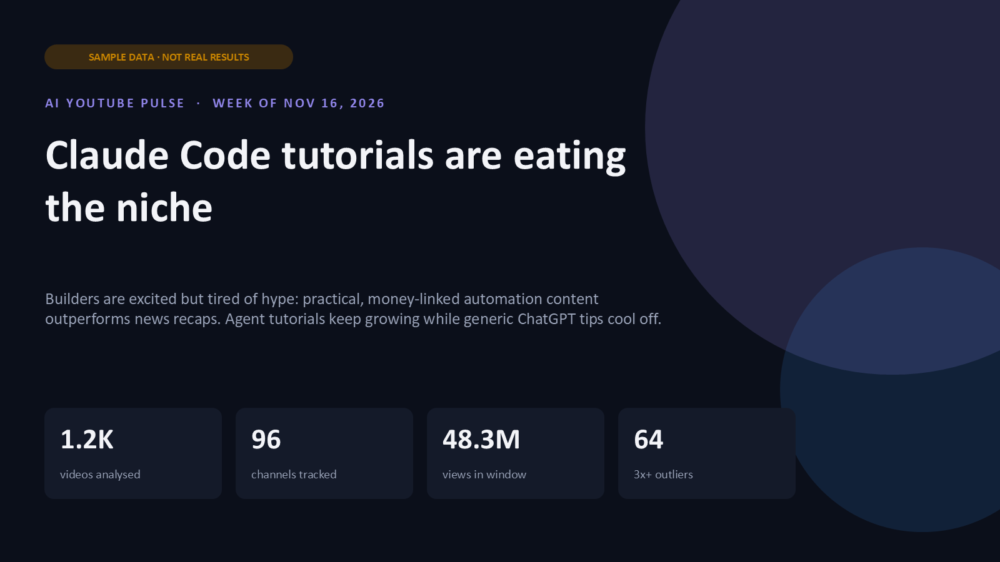
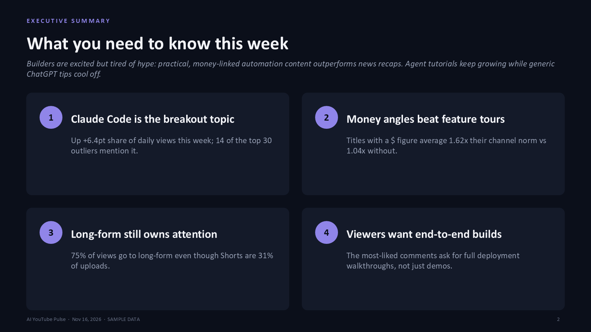
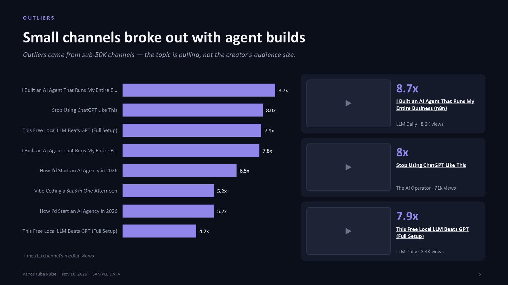
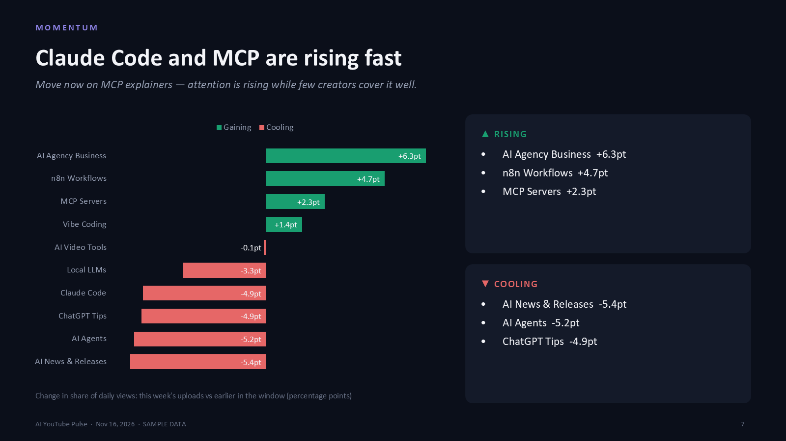
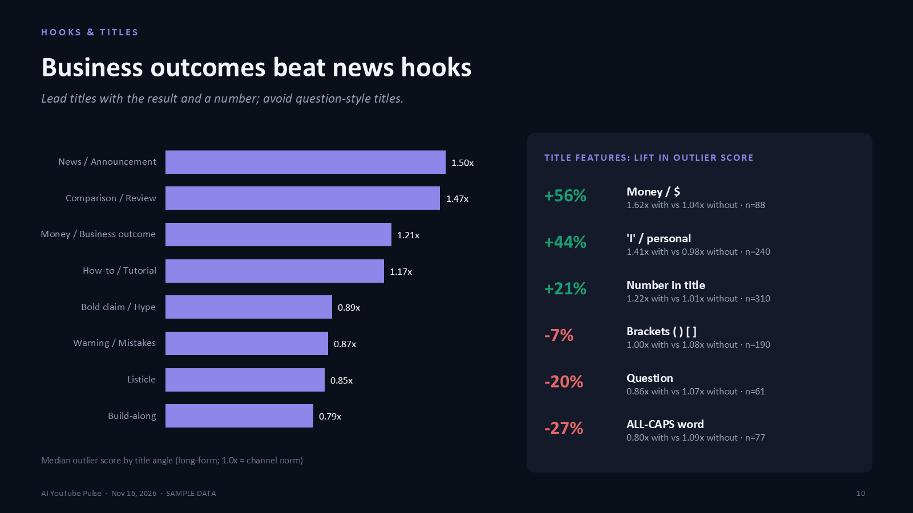
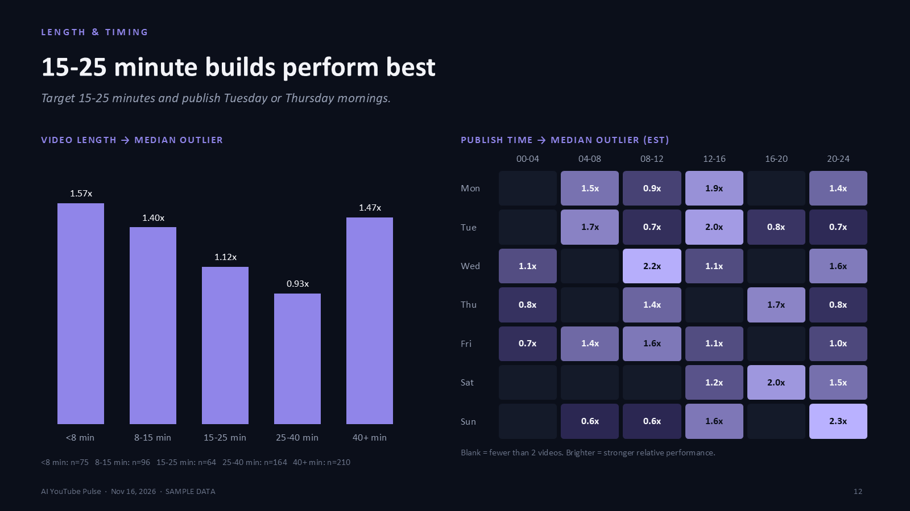
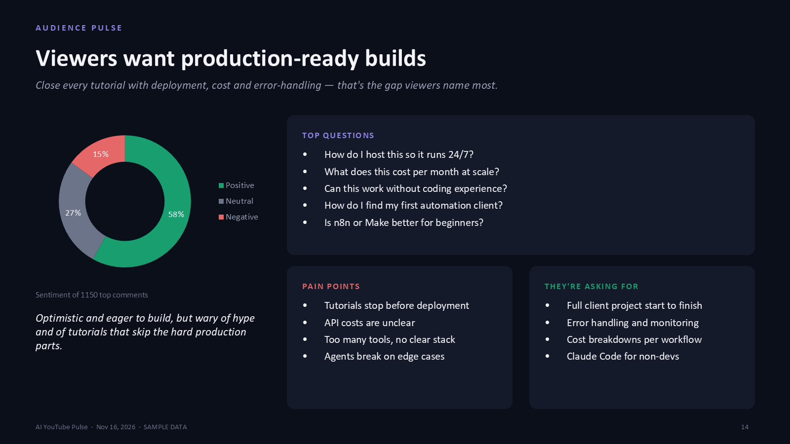
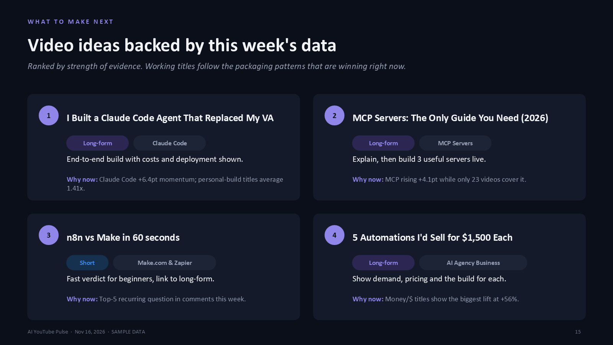
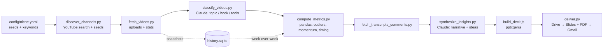

# AI YouTube Pulse

**An automated market-intelligence pipeline for YouTube creators.** Every week it gathers thousands of videos
from the AI / AI-automation niche, works out what's actually working (breakout videos, rising topics,
winning title patterns, best length and posting time, audience sentiment), and emails a designed,
chart-heavy slide deck with data-backed video ideas.



> Screenshots and [`docs/sample-deck.pptx`](docs/sample-deck.pptx) were generated with **sample data**
> in demo mode (`--demo`). They show the output format, not real results.

## Highlights

- **End-to-end automation**: discovery → data collection → AI tagging → analytics → slide deck → Google Drive + Gmail, on a weekly schedule.
- **Numbers from code, words from the LLM**: every figure is computed in pandas. Claude only classifies videos and writes commentary, constrained by a Pydantic schema and told to cite only the computed metrics. That avoids made-up statistics.
- **Metrics a creator can use**: the *outlier score* (a video's views ÷ its channel's median) finds breakout topics regardless of channel size. *Topic momentum* tracks shifts in share of attention.
- **Editable native charts**: decks are built with `pptxgenjs` as real PowerPoint charts, not images, then converted to Google Slides and PDF.
- **Fits in free API quotas**: the YouTube Data API budget is planned per call (search = 100 units, everything else = 1), and quota exhaustion is handled gracefully.
- **Resilient**: retry/backoff, resumable runs (`--from <step>`), failure-alert emails, and a SQLite history for week-over-week trends.

## Sample slides

| | |
|---|---|
|  |  |
|  |  |
|  |  |



## Architecture



The project follows a **Workflows / Agents / Tools** split: plain-language SOPs in `workflows/`, deterministic
Python/Node scripts in `tools/`, and an AI agent (or the scheduler) that runs them in order.

| Step | Tool | What it does |
|---|---|---|
| 1 | `discover_channels.py` | Builds the channel set from seeds, keyword search results and past runs |
| 2 | `fetch_videos.py` | Pulls 30 days of uploads + stats; filters off-niche channels; snapshots to SQLite |
| 3 | `classify_videos.py` | Claude tags each video (topic from a stable weekly taxonomy, hook type, tools, relevance) |
| 4 | `compute_metrics.py` | All analytics: KPIs, outliers, topic momentum, title-feature lift, duration/time heatmap |
| 5 | `fetch_transcripts_comments.py` | Transcripts of top performers + most-liked comments |
| 6 | `synthesize_insights.py` | Claude writes the summary, slide takeaways, audience pulse, 8 video ideas |
| 7–8 | `build_deck_data.py`, `build_deck.js` | Downloads thumbnails, builds the 17-slide themed deck |
| 9 | `deliver.py` | Uploads to Drive (as Google Slides), exports PDF, sends HTML email with attachments |

## Quick start: demo mode (no API keys)

```bash
python -m venv .venv
.venv/Scripts/python -m pip install -r requirements.txt     # macOS/Linux: .venv/bin/python
npm install
.venv/Scripts/python tools/run_weekly.py --demo
# -> .tmp/run_demo/deck.pptx
```

## Full setup (live data)

1. Google Cloud: enable **YouTube Data API v3**, **Drive API** and **Gmail API**. Create an API key and a Desktop OAuth client (`credentials.json` in the project root). Publish the OAuth app to *Production* so refresh tokens don't expire after 7 days.
2. Copy keys into `.env`: `YOUTUBE_API_KEY`, `ANTHROPIC_API_KEY`, `REPORT_EMAIL`.
3. `.venv/Scripts/python tools/google_auth.py` (one-time browser consent).
4. `.venv/Scripts/python tools/run_weekly.py --no-send` for a dry run, then without `--no-send` to email it.
5. Schedule `run_weekly.bat` weekly (Windows Task Scheduler) or the equivalent cron job.

Tune the niche in [`config/niche.yaml`](config/niche.yaml). The full operating procedure, cost and quota notes,
and known edge cases are in [`workflows/youtube_weekly_insights.md`](workflows/youtube_weekly_insights.md).

## Tech stack

Python (pandas, Pydantic, requests), Anthropic Claude API (structured outputs), YouTube Data API v3,
youtube-transcript-api, Node.js + pptxgenjs, Google Drive & Gmail APIs (OAuth), SQLite.
